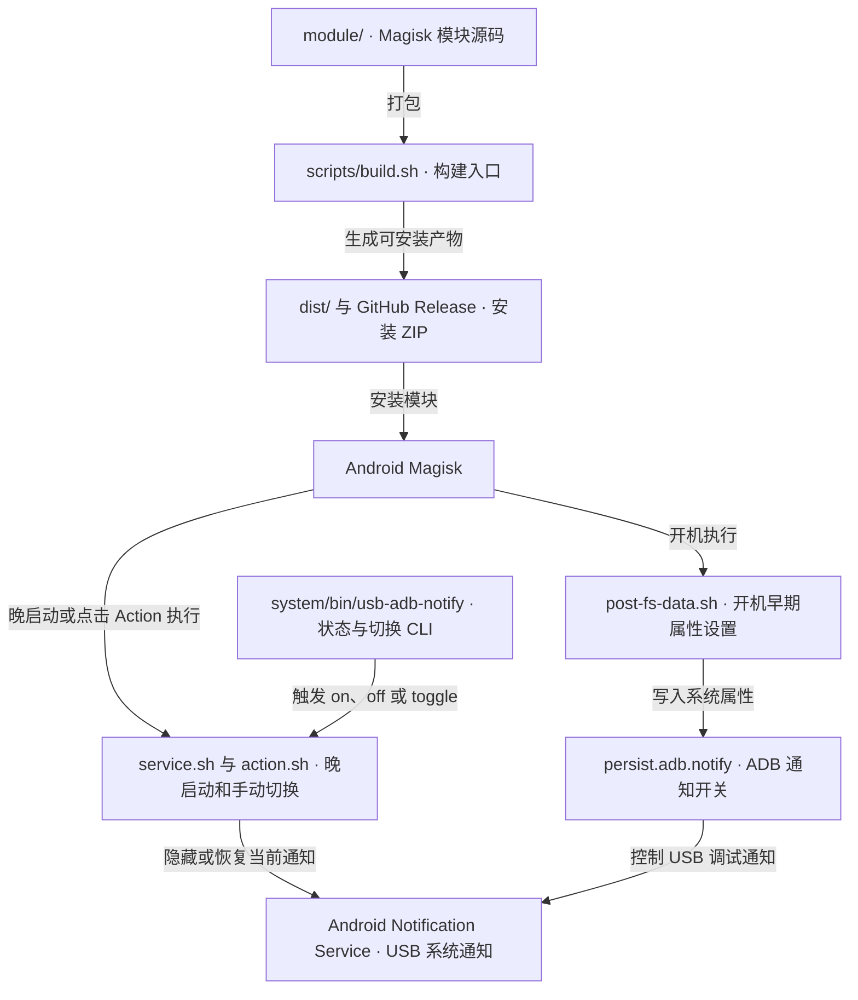

# USB Notify Magisk 模块

这个 Magisk 模块用于切换 Android 的 USB 调试常驻通知和 USB 充电/连接通知。

默认行为：隐藏“已连接到 USB 调试”通知和“正在通过 USB 为此设备充电”通知。

## 架构拓扑



## 原理

ADB 调试通知由 AOSP `UsbDeviceManager.updateAdbNotification()` 读取 `persist.adb.notify` 控制：

- `persist.adb.notify=0`：不显示 USB 调试通知。
- `persist.adb.notify=1`：恢复 Android 默认显示行为。

USB 充电/连接通知没有对应的 `persist.adb.notify` 属性开关，模块通过 `cmd notification snooze` 隐藏当前 Android 系统 USB 通知。

模块在开机早期通过 `post-fs-data.sh` 写入 ADB 属性，在 late start 阶段通过 `service.sh` 补做当前通知隐藏。当前处理的通知 key：

- USB 调试通知：`-1|android|26|null|1000`
- USB 充电/连接通知：`-1|android|32|null|1000`

## 安装

从 GitHub Release 选择已发布且核验过的安装 ZIP，在 Magisk 中安装后重启。历史制品保留原版本与字节；当前源码目标为 `1.0.0`，源码修改和本地构建不代表已经发布或完成设备升级。

也可以本地构建：

```sh
./scripts/build.sh
```

本地验证产物为 `dist/usb-adb-notify-toggle-1.0.0-local.zip`，包内明确标记 `local_validation=true`，`versionCode=0`，不占正式构建号。构建保留 `dist/` 中其他制品，正式包按版本和构建号命名，不覆盖不同字节的同号包。

## 版本与构建号

`release.json` 声明与冻结数字分支相同的产品版本。`module/module.prop` 的版本字段是模板，实际 ZIP 的 `version`、`versionCode` 和 `build.json` 由同一输入生成；正式 `versionCode` 等于 Core 分配的通用构建号，并限制在 Magisk Manager 的正整数容量 `1..2147483647`。不沿用源码中的手写编号，也不在模块仓维护计数器。

正式调用方先按统一机制核定模块 ID 的历史高水位并冻结源码、Core 和版本快照，再提供同次 `FAST_DEPLOY_*` context、`FAST_DEPLOY_CLIENT_VERSION_SNAPSHOT_FILE` 及显式 `FAST_DEPLOY_PACKAGE_CORE_ROOT`。入口核对该 Core 的精确提交、干净源码、模块身份和 `any` 架构，打包后由同一 Core 回读最终 ZIP。缺少正式输入时失败，不回落本地包。独立本地构建只需要 Python 标准库；不依赖相邻可变 checkout，不新增发布 Job，也不会上传或安装模块。

包旁的 JSON 收据记录包内身份、ZIP SHA-256 和实际大小；已安装模块可用 `su -c usb-adb-notify --build-info` 读取原包身份。包回读成功与 Android/Magisk 实际安装升级分别验收。历史源码编号 `3` 仅是已知下界，正式状态初始化仍须核对完整分发历史。

无常驻 Job 的正式 run 使用已保存的 `config/package-runs/module.json` 与 Core 的 `shared/package_run.py`。调用方提供冻结的 `1.0.0` checkout、明确 Core、持久制品根和收据根；入口分配并保存一次输入快照，再调用现有 `scripts/build.sh`。`dist/` 中的正式原包与 run 内的 ZIP 保持相同字节，同 run 重放复用原号和原包。此入口不上传 GitHub Release，也不安装设备。

历史 GitHub `v1.0.1` ZIP 的模块 ID 为 `usb_adb_notify_toggle`；当前源码在命名改动后使用 `usb-adb-notify-toggle`。两者属于不同 Magisk 安装目录，不能把当前包构建成功视为旧 ID 的就地升级。发布和设备验收时须核实实际安装身份及旧模块处理，历史 Release 保留原始字节。

```bash
python3 scripts/test_build_package.py
# 显式测试候选 Core；测试自行建立临时 Git 仓与状态，不改生产状态。
FAST_DEPLOY_TEST_PACKAGE_CORE_ROOT=/absolute/fast-deploy-core python3 scripts/test_build_package.py
```

## 使用

可以在 Magisk 模块列表里点击本模块的 Action 按钮切换，也可以执行：

```sh
su -c usb-adb-notify status
su -c usb-adb-notify off
su -c usb-adb-notify on
su -c usb-adb-notify toggle
su -c usb-adb-notify --build-info
```

`off` 会设置 `persist.adb.notify=0`，并隐藏 USB 调试通知与 USB 充电/连接通知。

`on` 会设置 `persist.adb.notify=1`，并恢复系统默认显示行为。

## 注意

- 本模块只处理 USB 调试通知和 USB 充电/连接通知，不处理 sing-box、VPN、投屏、文件传输工具等第三方前台服务通知。
- `post-fs-data.sh` 会在开机早期写入属性，`service.sh` 会在晚启动阶段补做当前通知隐藏。
- 从隐藏切回显示时，通知不一定立刻重新出现；通常需要重插 USB、切换 USB 调试或重启后触发系统重新发通知。
- 卸载模块时会恢复 `persist.adb.notify=1`，并 unsnooze 当前模块处理的系统通知，避免把设备长期留在隐藏状态。

## 目录结构

```text
module/
  META-INF/com/google/android/
  action.sh
  common.sh
  customize.sh
  module.prop
  post-fs-data.sh
  service.sh
  system/bin/usb-adb-notify
  uninstall.sh
scripts/
  build.sh
```

## 工作区治理

本仓库纳入 `darren-space` 后按轻量 tooling repo 管理：

- 工作区标准入口：`../../harness/docs/workspace/standards/README.md`
- 终端脚本输出标准：`../../harness/docs/workspace/standards/tooling/terminal-output-golden-path.md`
- Magisk 模块标准：`../../harness/docs/workspace/standards/magisk-module/magisk-module-golden-path.md`

## 参考资料

- AOSP `UsbDeviceManager`：<https://android.googlesource.com/platform/frameworks/base/+/5ac72a2/services/java/com/android/server/usb/UsbDeviceManager.java>
- [Magisk 模块格式](https://topjohnwu.github.io/Magisk/guides.html#moduleprop)与 [Manager 原生 versionCode 类型](https://github.com/topjohnwu/Magisk/blob/master/app/core/src/main/java/com/topjohnwu/magisk/core/model/module/Module.kt)。

## License

GPL-3.0。模块安装器脚本来自 Magisk 官方模块 installer 机制，按 GPL 授权发布更稳妥。
